# Email Sync: what it does and how it decides

Status: built. Last revised Nov 2026.

## Contents

1. [In short](#1-in-short)
2. [Words used in this document](#2-words-used-in-this-document)
3. [Set up](#3-set-up)
4. [How one sync runs](#4-how-one-sync-runs)
5. [How one email is decided](#5-how-one-email-is-decided)
6. [Examples](#6-examples)
7. [States](#7-states)
8. [Settings and fixed values](#8-settings-and-fixed-values)
9. [Limits](#9-limits)
10. [What changed in Nov 2026](#10-what-changed-in-nov-2026)
11. [Appendix: stage wording](#appendix-stage-wording)

Related: `docs/REQUIREMENTS.md` (Round 11, Round 12 and Round 23), `docs/HIGH_LEVEL_DESIGN.md`.

## 1. In short

Email Sync reads your Gmail inbox and keeps the status of your roles up to date.
You do not type in "Interview Ongoing" or "Rejected" yourself.

- **It reads.** New mail in the inbox, read-only. It never changes, deletes or sends mail.
- **It decides.** For each email it works out two things: what the email says, and which role it is about.
- **It proposes.** Most changes wait in the Email Sync tab for you to accept or discard.
- **It applies on its own in one case only.** A clear interview invite moves a role from Applied to Interview Ongoing.
- **It can be undone.** Every automatic change has an Undo button.
- **The AI is a second opinion.** It is asked only when the plain rules cannot decide. It sees three things: sender, subject and the first 400 characters.

The whole idea in one picture:

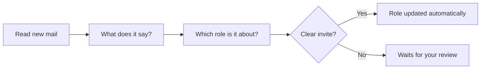

Mail that does not concern a role you applied to is ignored.

## 2. Words used in this document

| Word | Meaning |
|---|---|
| **Stage** | What an email says: interview, rejected, offer or closed. |
| **Status** | The status of a role in the app, such as Applied or Interview Ongoing. |
| **Update** | One row in the Email Sync tab: an email, a role and a proposed new status. |
| **Review needed** | An update that waits for you. Nothing has changed yet. |
| **Candidate role** | A role the email might be about. |
| **Signal** | How an email was linked to a role: sender domain, subject or body. |
| **Confidence** | How sure the app is that it picked the right role: High, Medium or Low. |
| **Rules** | The built-in word lists and matching. No AI. |
| **Tracked roles** | Roles with status Applied, Interview Ongoing or Interview cleared. Roles in any other status ignore email. |

## 3. Set up

1. In Config, Email Sync: enter your Gmail address.
2. In your Google account: turn on 2-step verification, then create an app password (16 letters).
3. In the terminal: `export JOBSYNC_APP_PASSWORD="<the 16 letters>"`.
4. In the same terminal: `jobscan serve`.

Until both the address and the password are set, sync does not run. The Email Sync tab says what is missing.

Buttons on the Email Sync tab:

- **Sync now:** reads new mail straight away. A sync also runs on its own every few hours.
- **Re-read last 30 days:** forgets which mails were seen in the last 30 days and checks them all again. Use it after a settings or rules change. A mail never gets two updates.

## 4. How one sync runs

A sync is one pass over new mail. Each mail goes through the decision in section 5.

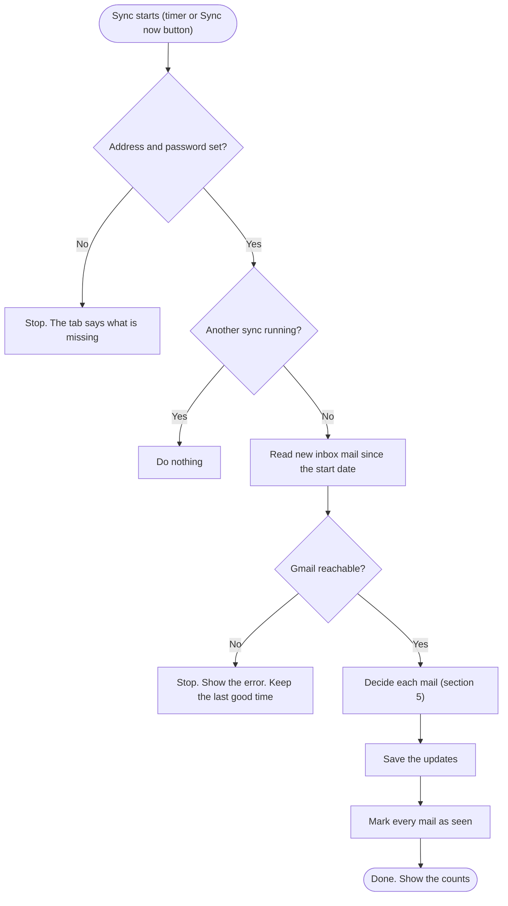

Where reading starts:

| Run | Start date |
|---|---|
| First sync | Today minus 30 days (`sync_first_days`) |
| Later syncs | Last good sync minus 2 days |
| Re-read | Today minus 30 days |

Why 2 extra days: Gmail's date search has no time part, and mail can arrive late. Mails already seen are skipped, so reading twice is safe.

Rules for reading:

- Only the inbox. Newest 1500 mails at most.
- Every mail read is marked as seen, even if it was ignored. A seen mail is not read again, except by Re-read.

## 5. How one email is decided

Each email goes through five checks, in this order. Each check has its own chart.

1. What stage does the email show?
2. Does it mention a role I applied to?
3. Is the AI needed to settle the stage?
4. Which role is it, and how sure am I?
5. Does the status change, and does it need my review?

Only some answers stop the email (it is ignored and no update is made):

- Check 1: only thanks-for-applying wording.
- Check 2: no company matches.
- Check 3: the AI gives no usable stage.
- Check 5: nothing would change, or the same update already exists.

An email with no stage wording is not stopped by check 1. It continues, and the AI may supply the stage.

### 5.1 What stage does the email show?

The app reads the subject and the first 3000 characters of the body.
It looks for fixed wording in four groups: rejected, closed, offer and interview (appendix).
A calendar invite counts as interview wording.
The sender is not used here.

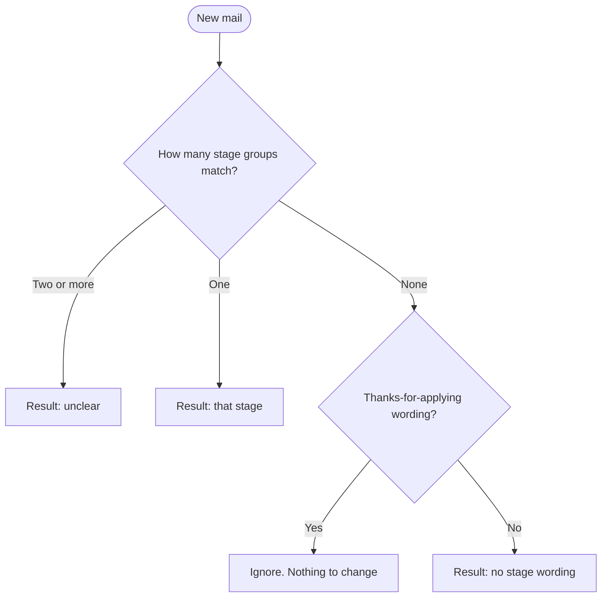

- **Unclear** means two or more stages at once. Example: "we are not moving forward ... your interview with our team".
- Each phrase counts only as whole words. "round 1" does not match inside "around 10 am".

### 5.2 Does it mention a role I applied to?

Each tracked role is checked, using only the company name.
The job title is not used here. Many companies share the same title, so it cannot say which company wrote.
The title is used only in check 4, to choose between several candidate roles.

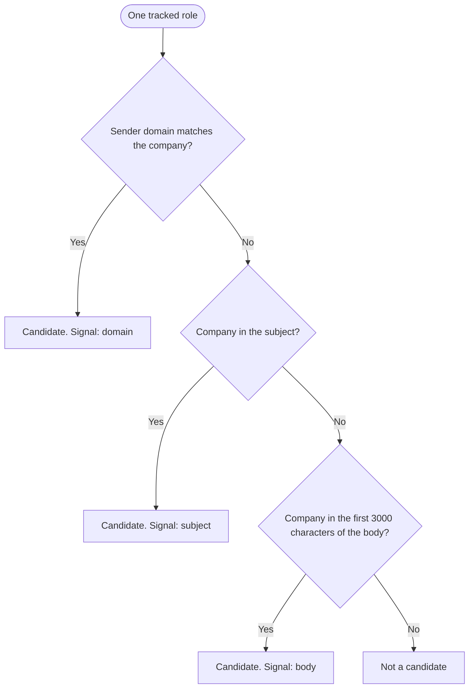

If no role becomes a candidate, the email is ignored.

How the domain is matched:

- The company name is cleaned first: lower case, words like Pvt, Ltd, Pte, Pty, GmbH, Plc, Inc, LLC, Technologies, India and Solutions are removed, the rest is joined. "YouTrip Pte Ltd" becomes `youtrip`.
- The sender domain is split at the dots. The ending (`com`, `in`) is left out.
- It matches if the company name equals one whole part, with hyphens ignored. `jobs.youtrip.com` matches "YouTrip".
- It also matches if one part is the name plus a recruiting word: careers, jobs, hr, talent, recruit, recruiting, hiring. `careers-youtrip.com` matches.
- It does not match inside a longer word. "Ola" does not match `viola.com`. "Tesco India" does not match `tescobank.com`.
- Mail servers that carry many companies never match by domain: Gmail, Outlook, LinkedIn, Naukri, Greenhouse, Lever, Workday and similar. For these, the company must appear in the subject or body.
- Names shorter than 3 letters never match.

How the subject and body are matched: the company words must appear as whole words, in order.

Roles at status Interview cleared are candidates only for rejected and closed mail.

### 5.3 Do I need the AI?

The AI is asked in two situations only.
In both, a company you applied to must already match.
The AI is never used for mail about other companies, or for thanks-for-applying mail.
The AI can be switched off in Config (`sync_use_ai`).

**Situation A: the email has no stage wording.**
This is the mail the rules would otherwise miss.

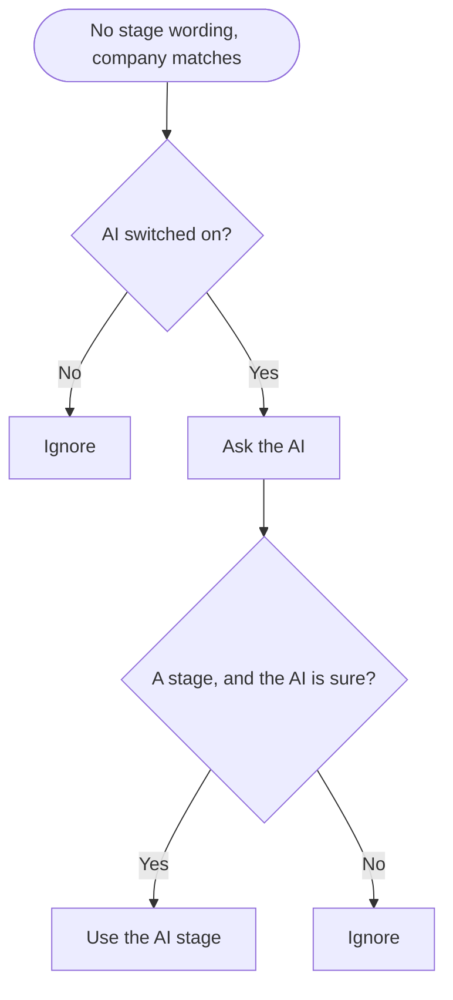

"No" covers three answers: the AI says none, the AI is unsure, or both tries failed. In all three, no update is made. The mail is still marked as seen.

**Situation B: the email is unclear.**
The rules saw two or more stages.

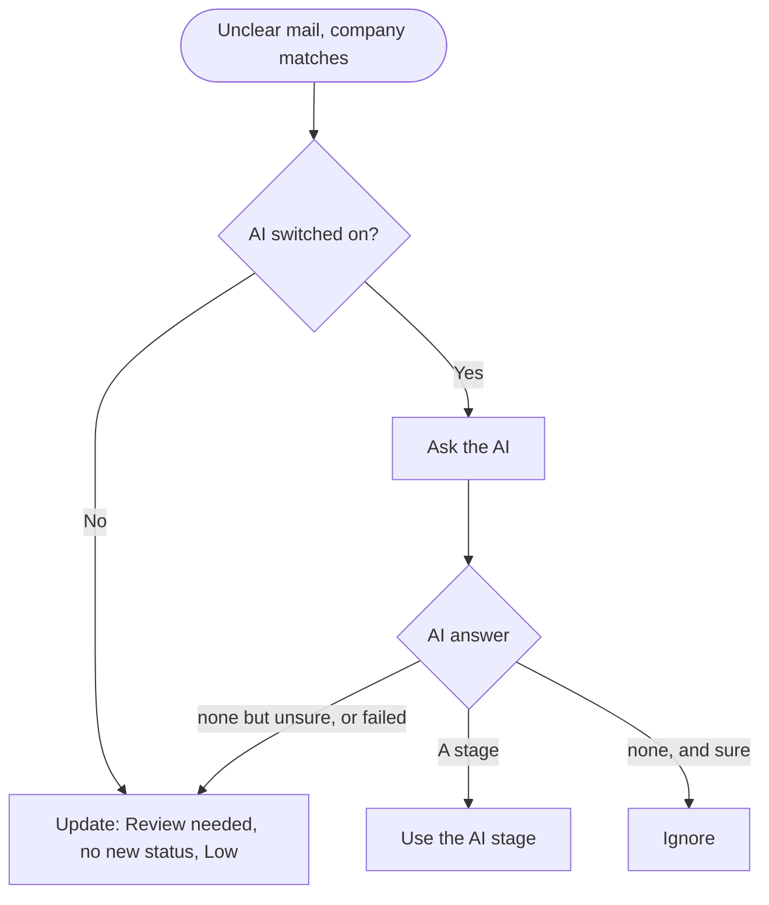

An update with "no new status" says "The email could not be understood. Please check it." You can only discard it.

How the AI is called:

- **Sent:** the sender, the subject and the first 400 characters of the body. Nothing else.
- **Asked:** which stage (interview, rejected, offer, closed or none) and whether it is sure.
- **Retry:** a failed call or an unreadable reply is tried once more after 5 seconds. A refused key (401, 403) or a wrong address (404) is not retried.
- **Never automatic:** a change decided by the AI always waits for your review.

### 5.4 Which role is it, and how sure am I?

More than one candidate role can exist, for example two roles at the same company.

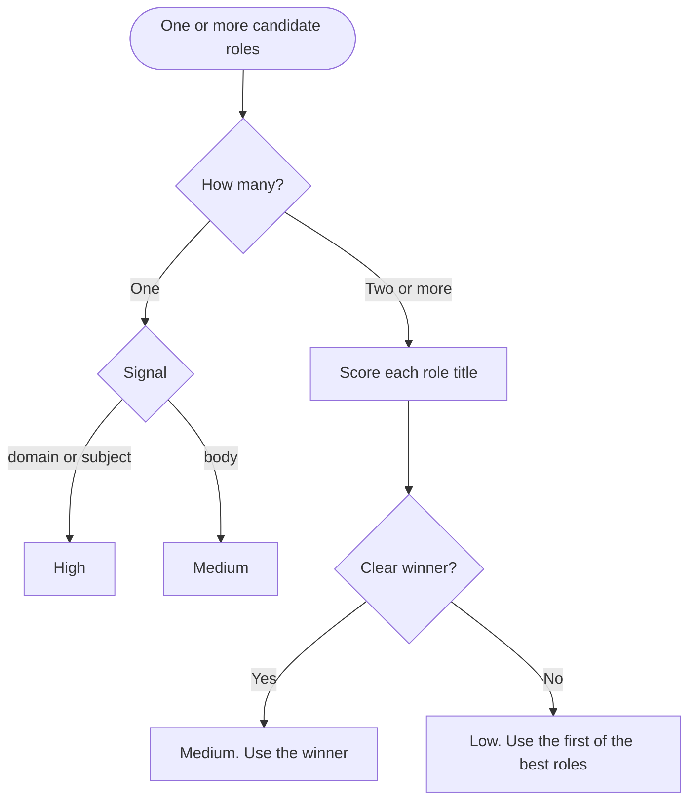

- **Title score:** the share of the title's words that appear in the subject or body. Example: "Technical Program Manager" with 2 of 3 words found scores 0.67. It is exact word matching, not a semantic search.
- **Clear winner:** the best score is at least 0.8, and at least 0.2 above the next role.
- **Tie:** the role at Interview Ongoing is preferred, then the first in the list.
- **Not compared:** when there are several candidates, the signal (domain, subject, body) is ignored. Only the title decides. See the limits in section 9.
The update then carries the note: "N roles at this company match equally. Check the role."

The confidence above comes from fixed rules and describes the role match.
If the stage came from the AI, the confidence is lowered, because an AI answer is less certain than fixed wording.
This is why an AI answer is never applied automatically.

| Confidence from the rules above | AI sure | AI unsure |
|---|---|---|
| High | Medium | Low |
| Medium | Medium | Low |
| Low | Low | Low |

### 5.5 Does the status change, and does it need my review?

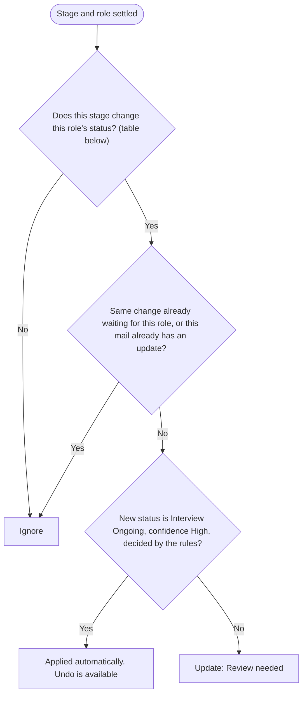

What each stage does to each status:

| Current status | interview | rejected | offer | closed |
|---|---|---|---|---|
| Applied | Interview Ongoing (automatic if High) | Initial screening rejected | Interview cleared | Closed |
| Interview Ongoing | no change | Interview phase rejected | Interview cleared | Closed |
| Interview cleared | no change | Interview phase rejected | no change | Closed |
| Any other status | no change | no change | no change | no change |

Rules that always hold:

- All interview rounds map to Interview Ongoing. There are no per-round statuses.
- A status never moves backwards.
- Only "Applied to Interview Ongoing" is automatic. It needs High confidence and a decision by the rules, not the AI.
- Every other change waits for you. This includes every rejection. This is a standing decision.

## 6. Examples

| Email | Stage | Role match | What happens |
|---|---|---|---|
| "Interview invite" from `talent@kestrelbank.example`, role at Applied | interview | one role, by domain: High | Applied automatically to Interview Ongoing. Undo available |
| "We will not be moving forward" from `careers@orbitretail.example` | rejected | one role, by domain: High | Review needed: Initial screening rejected. Rejections are never automatic |
| "Let's talk around 10 am tomorrow" from a company you applied to | none (not "round 1") | one role | AI is asked. If it says none and is sure, the mail is ignored |
| "Not moving forward ... your interview with our team" | unclear | one role | AI is asked. A stage is used and reviewed. None and sure is ignored. None but unsure keeps an update that cannot be understood |
| Rejection, company has two roles titled "Chef" | rejected | tie: Low | Review needed. Note: "2 roles at this company match equally. Check the role." |
| Rejection for a role at Interview cleared | rejected | one role | Review needed: Interview phase rejected |
| Offer email for a role at Interview cleared | offer | one role | Ignored: nothing to change |
| Newsletter from a company you did not apply to | none | no candidate | Ignored |
| "Thanks for applying" | received | n/a | Ignored |

## 7. States

### 7.1 An update (a row in the tab)

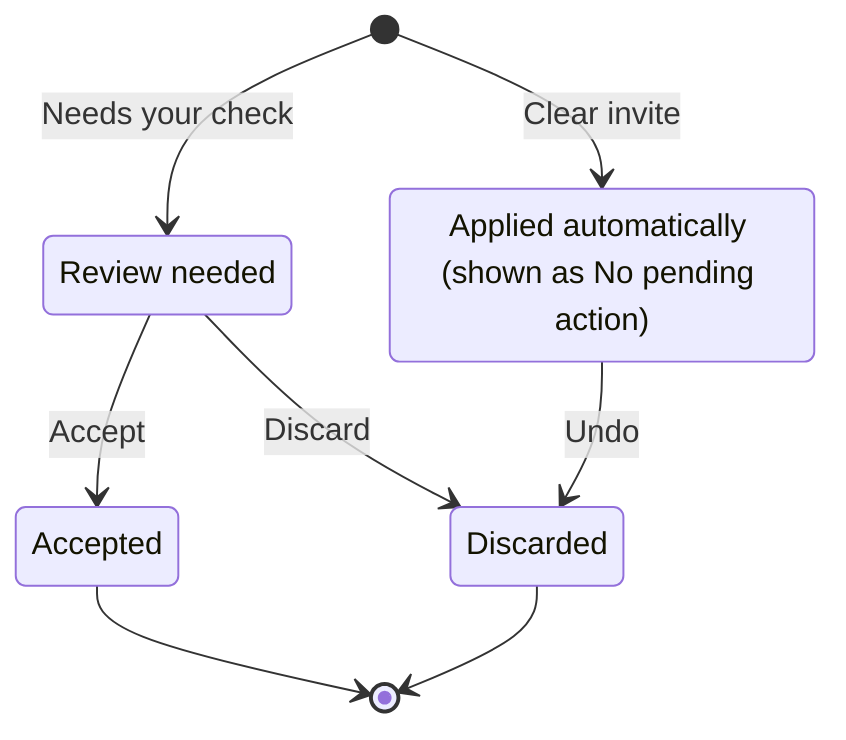

- **Review needed:** nothing has changed yet.
- **Accept:** sets the new status, but only if the role still has the status it had when the update was made. If you changed it meanwhile, the update is discarded with a note and the role is left alone.
- **Undo:** restores the previous status, under the same condition.
- **No new status:** an update that could not be understood can only be discarded.

### 7.2 A role's status, as sync can change it

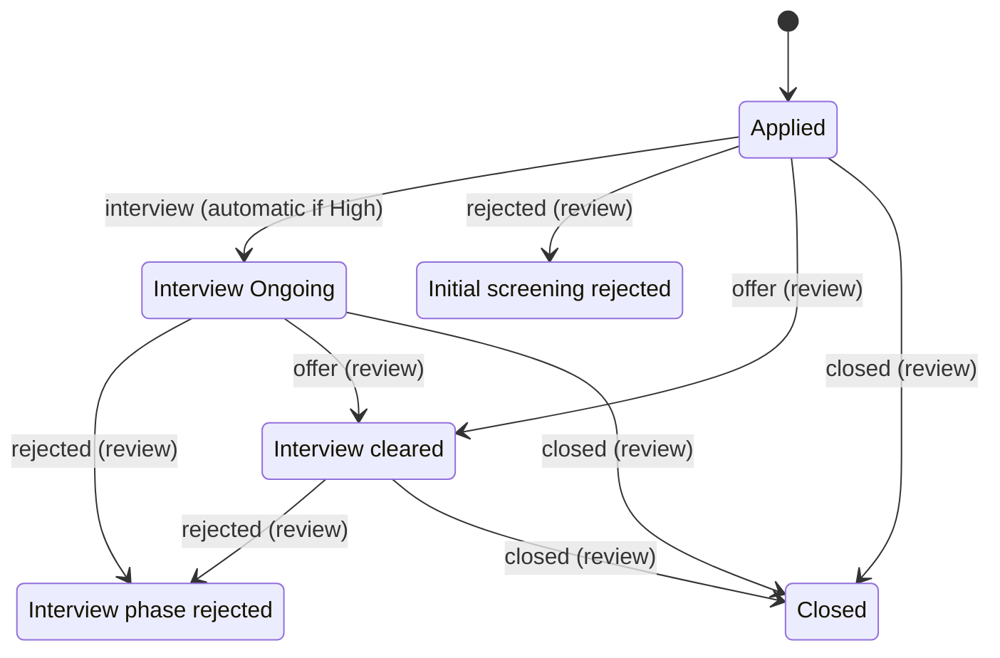

You can still set any status by hand.

### 7.3 A sync run

"Stuck" means a sync was marked as running but never finished. Examples: the app was closed, the computer went to sleep, or the program crashed mid-sync. After 30 minutes a new sync may start. Without this, one crash would block sync for good.

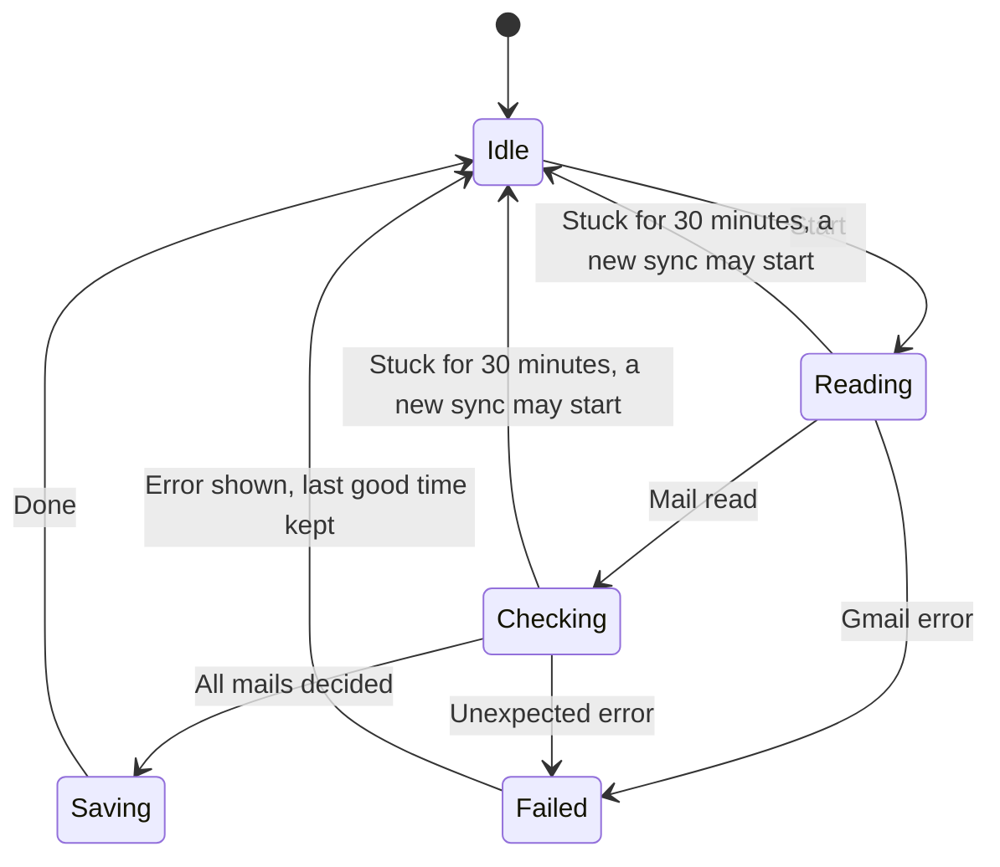

## 8. Settings and fixed values

Settings you can change in Config:

| Setting | Default | Range | Meaning |
|---|---|---|---|
| `sync_email` | empty | email | Gmail address. Empty keeps sync off. |
| `sync_password_env` | `JOBSYNC_APP_PASSWORD` | variable name | Terminal variable that holds the app password. |
| `sync_every_hours` | 4 | 1 to 24 | Time between scheduled syncs. |
| `sync_first_days` | 30 | 1 to 90 | Days read on the first sync. |
| `sync_use_ai` | on | on or off | Allow the AI step (section 5.3). |

Fixed in the code:

| Value | Number |
|---|---|
| Newest mails read per sync | 1500 |
| Text read per email (stage and company) | subject plus first 3000 characters |
| Overlap on later syncs | 2 days |
| Text sent to the AI | sender, subject, first 400 characters |
| Wait before the AI retry | 5 seconds (a short pause for a brief network or rate-limit blip. Not tuned on real data) |
| A sync counts as stuck after | 30 minutes |
| Re-read button | last 30 days |

## 9. Limits

Know these before trusting a quiet review queue.

- **Inbox only.** Mail filed under other labels is not read.
- **Fixed wording.** Stage wording is a fixed list (appendix). The AI catches other wording only when the company matches.
- **HTML mail** is turned into text by removing tags. Entities such as `&nbsp;` are not decoded.
- **Ignored mail is gone.** A mail with no stage wording, or one the AI could not help with, is marked as seen. Only Re-read looks at it again.
- **AI sees 400 characters.** A stage far down the body can be missed.
- **No cap on AI calls.** A first sync over 30 days can make many calls if many mails mention a company you applied to.
- **No rate pacing in sync.** The one retry may not be enough when the AI provider's per-minute limit is hit.
- **Signal strength is not compared** when several roles are candidates. A role matched by sender domain does not beat a role whose company is only named in the body. Only the title decides. A fix is proposed, not built.
- **Other statuses** (Not Applied, Skipped, Not relevant, Closed, the rejected ones) never react to mail.
- **Offers** move a role to Interview cleared. There is no "offer received" status.
- **Other stages are not automatic.** Only Applied to Interview Ongoing is. This was reviewed in Nov 2026 and kept.

## 10. What changed in Nov 2026

Reason: real mail was missed, and some mail was read wrongly.

| # | Change | Why |
|---|---|---|
| 1 | Stage wording matches whole words only | "round 1" was found inside "around 10 am" and could change a status automatically |
| 2 | Company matching uses whole domain parts. Pte, Pty, GmbH and Plc are dropped from names | "YouTrip Pte Ltd" never matched `youtrip.com`. "Ola" matched `viola.com` |
| 3 | One 3000-character window for stage and company | They used 1500 and 2000, with no reason |
| 4 | Roles at Interview cleared react to rejected and closed mail | A rejection after clearing interviews was ignored |
| 5 | A note on the update when several roles tie | The update pointed at one role without saying it was a guess |
| 6 | Mail with no stage wording, from a company you applied to, goes to the AI | Such mail was dropped and never seen again |
| 7 | An AI answer of "none and sure" is ignored | It created an update and added noise |
| 8 | One retry for a failed AI call | One failed call lost the mail |

Checks the tests cover:

- "We can talk around 10 am" is not an interview. "Round 1 is on Monday" is. "Round 10" is not.
- "YouTrip Pte Ltd" matches `jobs.youtrip.com`. "Ola" does not match `viola.com`.
- A stage phrase at character 2800 of the body is found.
- A rejection or closure for a role at Interview cleared creates an update. An interview or offer mail does not.
- With an Interview cleared role and an Applied role at one company, an invite goes to the Applied role.
- Two roles with equal titles produce the tie note.
- Mail with no stage wording reaches the AI only if the company matches a tracked role.
- No AI answer is ever applied automatically.
- A failed AI call is tried twice in total, except for a refused key.

## Appendix: stage wording

Phrases the rules look for (whole words, case ignored)

**Rejected:** we will not be moving forward, not moving forward, not to move forward, unable to move forward, not able to move forward, won't be moving forward, decided not to continue, will not be proceeding, not be proceeding, regret to inform, unable to proceed, decided not to proceed, not shortlisted, not been selected, not selected, move forward with other candidates, moving forward with other candidates, decided to pursue other candidates, not be able to take your application forward, not take your application forward

**Closed:** position has been closed, role has been closed, position has been filled, role has been filled, no longer accepting applications, requisition has been closed, hiring for this role has been paused, role is on hold, position is on hold, no longer hiring for this

**Offer:** pleased to offer, happy to offer, we would like to offer, extend an offer, offer letter, delighted to offer

**Interview:** schedule an interview, schedule a call, interview scheduled, interview invitation, invite you for an interview, invite you to an interview, invitation to interview, interview with, next round, technical round, intro call, introductory call, telephonic, video interview, your availability, round 1, round 2, round 3, first round, second round, final round. A calendar invite also counts as interview. A cancelled invite does not.

**Thanks for applying (ignored, no change):** thank you for applying, thanks for applying, application received, we have received your application, we've received your application, your application has been submitted, application was sent

If one email matches two or more of the first four groups, it is unclear.

