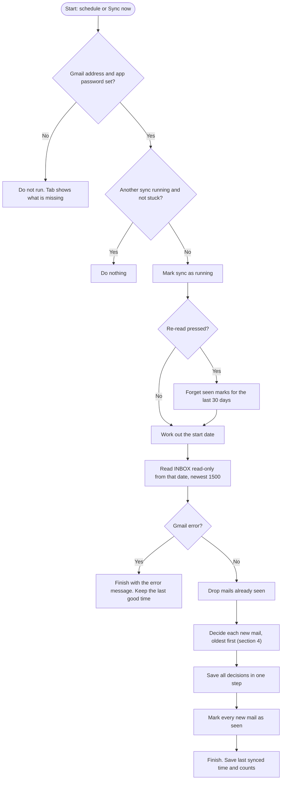
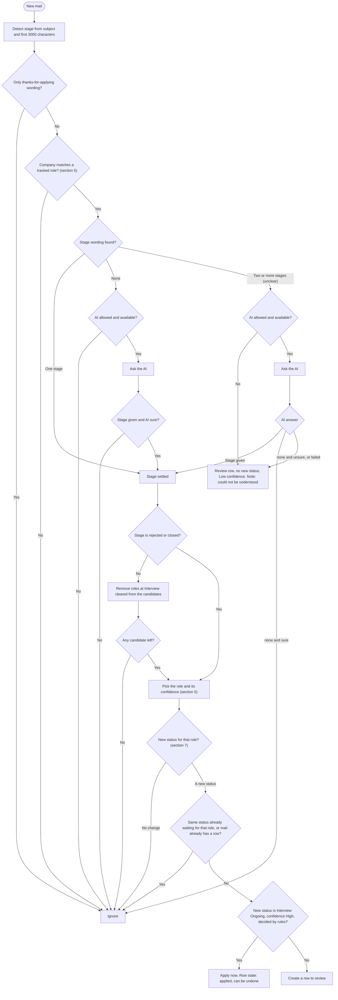
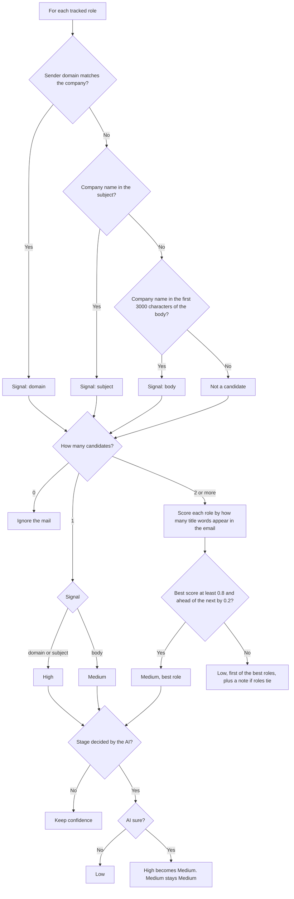
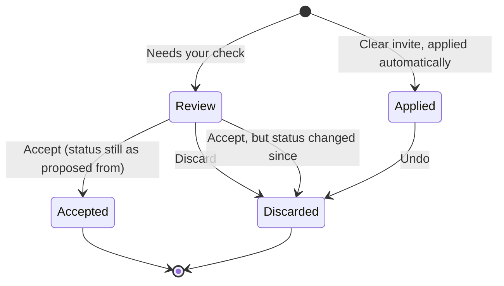
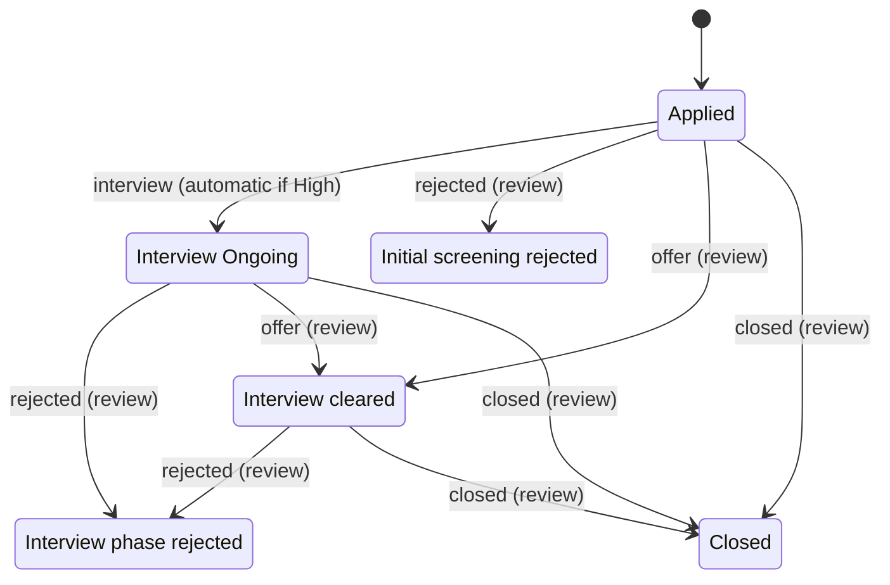
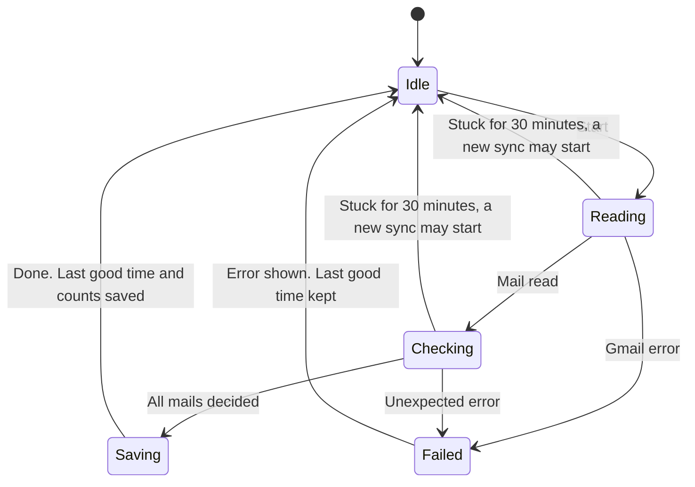

# Email Sync: requirements and logic

Status: built. Updated Nov 2026 (accuracy changes, section 9).

Email Sync reads your Gmail inbox and proposes status changes for roles you applied to.
It uses plain rules first. It asks the AI only when the rules cannot decide.
Only one kind of change is applied without asking: a clear invite moves a role to Interview Ongoing.
Everything else waits in the Email Sync tab for you to accept or discard.

Related: `docs/REQUIREMENTS.md` (Round 11, Round 12 and Round 23), `docs/HIGH_LEVEL_DESIGN.md`.

## 1. Goals and limits

- Keep role statuses current without typing them in.
- Never change a status backwards.
- Never send the whole mailbox anywhere.
- Never write to Gmail. The mailbox is opened read-only.
- Out of scope: sending mail, replying, reading other folders, reading attachments (except calendar invites).

## 2. Setup

- Config, Email Sync: your Gmail address.
- Terminal: `export JOBSYNC_APP_PASSWORD="<16-letter app password>"`, then `jobscan serve` in the same terminal.
- The Gmail account needs 2-step verification, which is required to create an app password.
- Without both, sync does not run. The Email Sync tab shows what is missing.

| Config setting | Default | Range | Meaning |
|---|---|---|---|
| `sync_email` | empty | email | Gmail address. Empty keeps sync off. |
| `sync_password_env` | `JOBSYNC_APP_PASSWORD` | variable name | Terminal variable that holds the app password. |
| `sync_every_hours` | 4 | 1 to 24 | Time between scheduled syncs. |
| `sync_first_days` | 30 | 1 to 90 | Days read on the first sync. |
| `sync_use_ai` | 1 (on) | 0 or 1 | Allow the AI to help (sections 5 and 6). |

Fixed values (not settings):

| Value | Number | Where used |
|---|---|---|
| Newest mails read per sync | 1500 | Reading |
| Text read per email | subject + first 3000 characters of the body | Stage and company checks |
| Overlap on later syncs | 2 days | Start date |
| Text sent to the AI | sender, subject, first 400 characters | AI call |
| Re-read button | last 30 days | Re-read |
| A running sync counts as stuck after | 30 minutes | Guard |

## 3. The whole flow

A sync starts on a schedule or with the Sync now button.
It reads new mail, decides what each mail means, saves the results in one step and records the outcome.
Every mail it reads is then marked as seen, including ignored mail, so it is not read twice.

Start date:

- First sync: today minus `sync_first_days`.
- Later syncs: last good sync minus 2 days. Gmail's date search has no time part, and mail can arrive late. Mails already seen are skipped, so the overlap is safe.
- Re-read: today minus 30 days.

## 4. What happens to one email

The email is read in three steps.
First the stage: what the wording says (interview, rejected, offer, closed).
Then the role: which role it is about.
Last the status: what the role would change to, and whether that needs your check.

Notes:

- "Ignore" means no row is made. The mail is still marked as seen.
- "Tracked role" means a role with status Applied, Interview Ongoing or Interview cleared.
- "Interview cleared" roles react to rejected and closed only (section 7).
- An unclear mail is one that shows two or more stages. Example: a rejection that says "your interview with our team".
- "Decided by rules" excludes any answer from the AI. An AI answer is never applied automatically.

## 5. Finding the role and its confidence

An email is matched to a role by company name only.
The role title is used only to choose between several roles at the same company.

Company matching rules:

- The company name is cleaned first: lower case, legal and filler words removed (Pvt, Ltd, Pte, Pty, GmbH, Plc, Inc, LLC, LLP, Corp, Technologies, India, Solutions, Services and similar), remaining words joined. Example: "YouTrip Pte Ltd" becomes `youtrip`.
- Names shorter than 3 characters never match.
- **Domain:** the sender domain is split at the dots. The company name must equal one whole part (not the ending such as `com`), with hyphens ignored. Or one part must be the name plus a recruiting word next to it: careers, jobs, hr, talent, recruit, recruiting, hiring.
  - Matches: `jobs.youtrip.com`, `careers-youtrip.com`, `youtripjobs.com`, `angel-one.in` for "Angel One".
  - Does not match: `viola.com` for "Ola", `tescobank.com` for "Tesco India".
- Senders that serve many companies never match by domain (Gmail, Outlook, LinkedIn, Naukri, Greenhouse, Lever, Workday and similar). For these, the company must appear in the subject or body.
- **Subject and body:** the company words must appear as whole words, in order. Space or hyphen between them is allowed.
- **Equal titles:** when several roles tie for best, the one already at Interview Ongoing is preferred, then the first. The row gets the note "N roles at this company match equally. Check the role."

Confidence values:

| Confidence | When |
|---|---|
| High | One role, matched by sender domain or subject, stage decided by the rules |
| Medium | One role matched by the body only. Or a clear title winner among several roles. Or a High match whose stage came from the AI |
| Low | Several roles without a clear title winner. Or the AI was unsure. Or the email could not be understood |

## 6. The AI step

The AI is a second opinion. It never sees the whole mailbox.

- **Sent:** the sender, the subject and the first 400 characters of the body. Nothing else.
- **Asked:** which stage the email shows (interview, rejected, offer, closed or none) and whether it is sure.
- **Used for two cases:**
  - Unclear mail (two or more stages).
  - Mail from a company you applied to with no stage wording at all.
- **Not used for:** mail from companies you did not apply to, and thanks-for-applying mail.
- **Switch:** Config `sync_use_ai`. Off means unclear mail goes straight to review, and mail with no wording is ignored.
- **Model:** the same service as resume tailoring (same key and Config values).

How each answer is handled:

| Mail type | AI answer | Result |
|---|---|---|
| Unclear | A stage | Row to review. Confidence at most Medium |
| Unclear | none, sure | Ignored. No row |
| Unclear | none but unsure, or the call failed | Review row, no new status, Low. Note: could not be understood |
| No stage wording | A stage and sure | Row to review. Confidence at most Medium |
| No stage wording | none, an unsure answer, or the call failed | Ignored. No row |

## 7. Which status a stage leads to

| Current status | interview | rejected | offer | closed |
|---|---|---|---|---|
| Applied | Interview Ongoing (automatic if High) | Initial screening rejected | Interview cleared | Closed |
| Interview Ongoing | no change | Interview phase rejected | Interview cleared | Closed |
| Interview cleared | no change | Interview phase rejected | no change | Closed |
| Any other status | no change | no change | no change | no change |

Rules:

- All interview rounds map to Interview Ongoing. There are no per-round statuses.
- Status never moves backwards.
- Only "Applied to Interview Ongoing" can be applied automatically, and only with High confidence from the rules.
- Every other change waits in the review list. This includes every rejection. This is a standing decision.
- Roles you have set to any other status are ignored by sync.

## 8. States

### 8.1 A sync row

Each proposed or applied change is one row in the Email Sync tab.

- **Review:** nothing has changed yet. A review row with no new status (could not be understood) can only be discarded.
- **Applied:** the role is already changed. Undo restores the previous status, but only if you have not changed it since. If you have, the row is marked Discarded and the role is left alone.
- **Accept:** applies the new status, but only if the role still has the status it had when the row was made. Otherwise the row is discarded with a note.

### 8.2 A role's status, as sync can change it

You can still set any status by hand. Sync never moves a role out of a status not shown here.

### 8.3 A sync run

## 9. Accuracy changes (Nov 2026)

Reasons: real mail was missed, and some mail was read wrongly.

| # | Change | Reason |
|---|---|---|
| 1 | Stage phrases match whole words only | "round 1" was found inside "around 10 am". A plain text hit could apply a status change automatically |
| 2 | Company matching by whole domain parts. Pte, Pty, GmbH and Plc dropped from names | "YouTrip Pte Ltd" never matched `youtrip.com`. "Ola" matched `viola.com` |
| 3 | One text window of 3000 characters for the stage and the company | The stage used 1500 and the company 2000, with no reason |
| 4 | "Interview cleared" roles react to rejected and closed mail | A rejection after clearing interviews was ignored |
| 5 | Note on the row when several roles tie | The row pointed at one role without saying it was a guess |
| 6 | Mail from a company you applied to with no stage wording goes to the AI | Such mail was dropped and never seen again |
| 7 | AI "none and sure" is ignored | It created a review row, which added noise |

Acceptance rules:

- "We can talk around 10 am" does not count as an interview.
- "Round 1 is on Monday" counts as an interview. "Round 10" does not.
- "YouTrip Pte Ltd" matches `jobs.youtrip.com`. "Ola" does not match `viola.com`.
- A stage phrase at character 2800 of the body is found.
- A rejection or closure for a role at Interview cleared creates a review row. An interview or offer mail does not.
- With an Interview cleared role and an Applied role at one company, an invite goes to the Applied role.
- Two roles with equal titles produce the tie note.
- Mail with no stage wording reaches the AI only if the company matches a tracked role. An AI answer of none, unsure or failed creates no row.
- No AI answer is ever applied automatically.

## 10. Known limits

- Only the INBOX is read. Mail filed under other labels is not.
- Stage wording is a fixed list (appendix). Other wordings are missed unless the AI step catches them.
- HTML mail is turned into text by removing tags. HTML entities such as `&nbsp;` are not decoded.
- Mail with no stage wording and no company match is ignored and never looked at again, except with Re-read.
- A failed AI call on mail with no stage wording is not retried, except with Re-read.
- There is no cap on AI calls per sync. A first sync over 30 days could make many calls if many mails mention a company you applied to.
- The AI sees 400 characters. A stage far down the body can be missed. Raising this to about 1000 is possible later.
- Other statuses (Not Applied, Skipped, Not relevant, Closed and the rejected ones) never react to mail.
- Offer detection moves a role to Interview cleared. There is no "offer received" status.

## Appendix: stage wording

Phrases the rules look for (whole words, case ignored)

**Rejected:** we will not be moving forward, not moving forward, not to move forward, unable to move forward, not able to move forward, won't be moving forward, decided not to continue, will not be proceeding, not be proceeding, regret to inform, unable to proceed, decided not to proceed, not shortlisted, not been selected, not selected, move forward with other candidates, moving forward with other candidates, decided to pursue other candidates, not be able to take your application forward, not take your application forward

**Closed:** position has been closed, role has been closed, position has been filled, role has been filled, no longer accepting applications, requisition has been closed, hiring for this role has been paused, role is on hold, position is on hold, no longer hiring for this

**Offer:** pleased to offer, happy to offer, we would like to offer, extend an offer, offer letter, delighted to offer

**Interview:** schedule an interview, schedule a call, interview scheduled, interview invitation, invite you for an interview, invite you to an interview, invitation to interview, interview with, next round, technical round, intro call, introductory call, telephonic, video interview, your availability, round 1, round 2, round 3, first round, second round, final round. A calendar invite also counts as interview. A cancelled invite does not.

**Received (ignored, no change):** thank you for applying, thanks for applying, application received, we have received your application, we've received your application, your application has been submitted, application was sent

If one email matches two or more of the first four groups, it is unclear.

