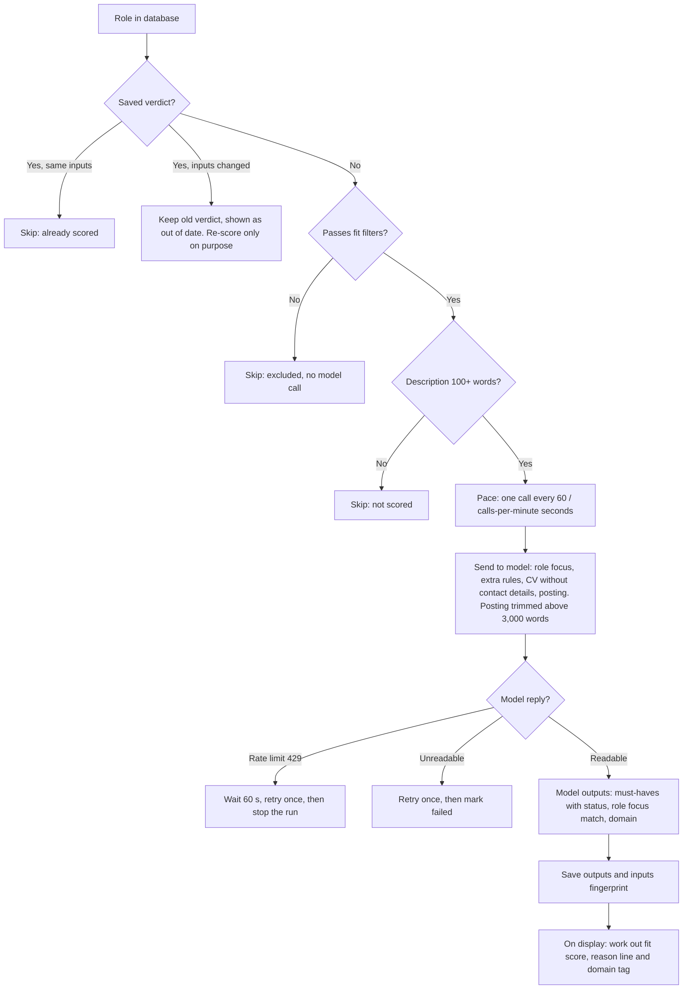
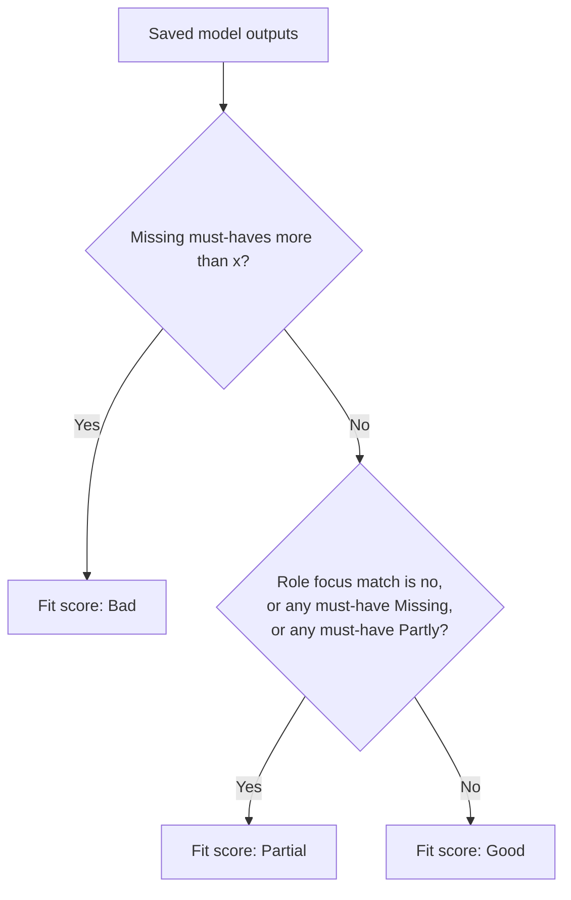
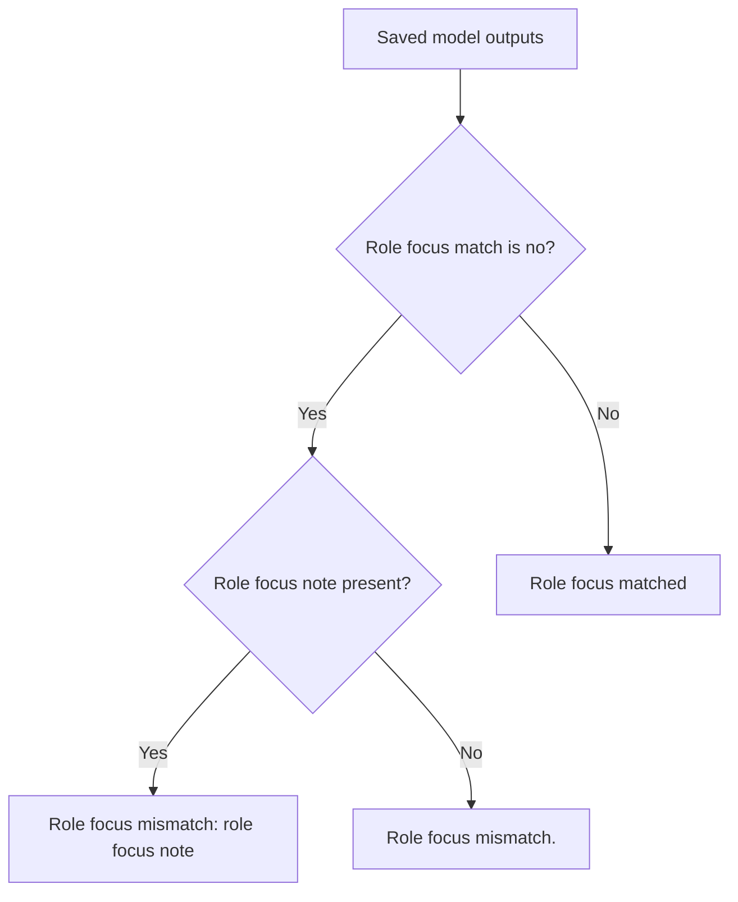

# Fit score logic

Terms used throughout: **role focus** (Config), **must-haves** with status **Met**, **Partly** or **Missing**, **fit score** (Good, Partial, Bad) and the **domain tag**.

## 1. From role to saved model outputs

- The model never gives the fit score. It returns must-haves with a status, the role focus match and the domain.
- There is no daily call cap. The calls-per-minute setting is the only pace limit. Set it from the model's requests-per-minute limit.
- A saved verdict is never re-scored automatically. Use `jobscan score --stale` or the Score button.

## 2. What the model returns

| Output | Meaning | Example |
|---|---|---|
| Must-have | A requirement the posting states. Nice-to-haves and years of experience are skipped. Up to 12. | "Kafka experience" |
| Status: Met | A CV line clearly shows it. The model copies that line as evidence. A Met with no evidence becomes Partly. | CV: "Built Kafka event pipelines for payments" |
| Status: Partly | The CV shows related experience only. | CV: "Worked on message queues" |
| Status: Missing | Nothing in the CV relates to it. | No streaming or queue experience in the CV |
| Role focus match | Yes or no: does the work in the responsibilities suit your role focus. | No |
| Role focus note | Written only when the match is no. At most 15 words, saying what the work really is. | "Operations-focused IT delivery, not cross-team technical program ownership" |
| Domain | Industry of the role against your role focus: match, close or different. Shown as a tag only. | close |

- The evidence line shows as a tooltip when you hover a Met item in the must-haves section of the role panel.
- The app does not check that the evidence line exists in the CV.

## 3. Fit score

`x` is "Must-haves allowed missing" in Config (default 2).

- Bad only when missing must-haves exceed `x`. With `x` = 3: 3 missing is Partial, 4 missing is Bad.
- A role focus mismatch gives Partial, never Bad by itself.
- Any Partly gives Partial.
- The domain does not affect the fit score. It is shown as a tag beside it, in the Roles list and the role panel.
- The fit score is worked out each time a role is shown, so changing `x` needs no new model call.

## 4. Reason line

| Model outputs | Reason line |
|---|---|
| Role focus match no, note "Operations-focused IT delivery, not cross-team technical program ownership" | Role focus mismatch: Operations-focused IT delivery, not cross-team technical program ownership |
| Role focus match no, no note | Role focus mismatch. |
| Role focus match yes | Role focus matched |

- Missing and Partly must-haves are not in the reason line. They show in the must-haves section of the role panel.
- Verdicts saved before this wording show the same two texts when read.
