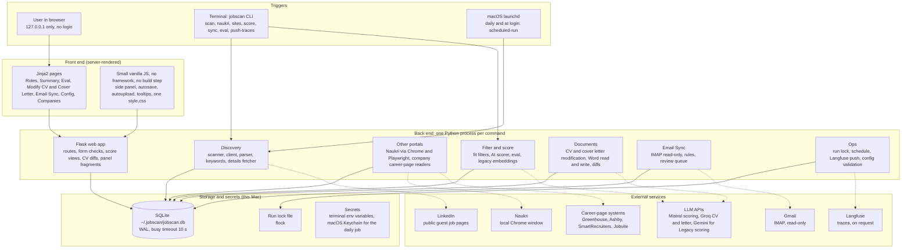

# Jobscan: High-Level Design

A local-first job search tracker for one user, running on a Mac. It finds roles, filters and scores them against a CV, helps modify the CV and cover letter, and tracks applications. Nothing runs in the cloud except calls to third-party services.

## 1. Design in one view

Dotted arrows are outbound internet calls. Gemini is used only when Legacy scoring is switched on.

## 2. End-to-end flow

Numbers show the order of calls. Phase 1 runs as a batch job. Phase 2 happens when you open the app.

```mermaid
flowchart TD
subgraph P1["Phase 1: find and score roles"]
  T1["launchd or jobscan CLI"] -->|"1 Start scan"| RUN["Scan runner<br/>takes the run lock"]
  RUN <-->|"2 Search each job title / listings"| SRC["LinkedIn, Naukri, company career pages"]
  RUN -->|"3 New listings"| FILT["Dedupe + fit filter"]
  FILT -->|"4 Save roles"| DB1[("SQLite")]
  FILT -->|"5 Roles without description"| DET["Details fetcher"]
  DET -->|"6 Fetch description"| LID["LinkedIn detail pages"]
  DET -->|"7 Save description"| DB1
  DET -->|"8 Roles that pass filters"| SCR["AI scorer"]
  SCR <-->|"9 Role + CV / 10 Model outputs"| MIS["Mistral"]
  SCR -->|"11 Save outputs"| DB1
end
subgraph P2["Phase 2: when you use the app"]
  YOU["You (browser)"] -->|"12 Open Roles tab"| WEB["Flask web app"]
  WEB <-->|"13 Read roles / save status, rating"| DB2[("SQLite")]
  WEB -->|"14 Modify CV or letter"| MOD["Document modifier"]
  MOD <-->|"15 Role + CV / 16 Proposed edits"| GRQ["Groq"]
  MOD -->|"17 Save request, Word file"| DB2
  WEB -->|"Sync button"| EM["Email Sync"]
  EM <-->|"18 Read recent mail / matching messages"| GML["Gmail"]
  EM -->|"19 Queue status changes"| DB2
end
```

Steps 4, 7 and 11 reuse stored data: repeats are skipped and a verdict is not requested again unless its inputs changed. The scoring steps are drawn in detail in [Fit score logic](FIT_SCORE_LOGIC.md).

## 3. Design choices

- **Local-first:** one user, one Mac, no hosted server. The web app binds to 127.0.0.1, so no login is needed. CV and notes stay on disk; only the text needed for a call goes to an LLM.
- **Simple stack:** Python, Flask, Jinja2, SQLite. No queue, no Redis, no front-end build. Easy to run, back up (one file) and debug.
- **Batch plus on-demand:** scans and scoring are CLI jobs, daily via launchd. The web app reads the database and runs single-role actions (score, modify CV).
- **Human in the loop:** the AI proposes and you approve every CV and letter change. Email Sync proposes status changes and you accept or reject. Re-scoring happens only on purpose.

## 4. Components and their jobs

| Area | Main modules | What it does |
|---|---|---|
| Web app | `web/app.py`, `forms.py`, `scores.py`, `diffs.py` | Serves pages, validates forms, builds score views, shows CV change diffs, returns fragments for the side panel. |
| LinkedIn scan | `scanner`, `client`, `parser`, `keywords`, `details` | Searches by your job titles within a time window, parses cards, skips repeats and skipped titles, fetches descriptions for recent roles. |
| Naukri, company sites | `naukri_*`, `sites_*` | Naukri via a visible local Chrome (Playwright, no stored cookies). Company career pages via public job-list endpoints. |
| Fit filter | `fit_filters`, `fit_book` | Rule-based checks (too junior, excluded company, and so on) before any AI call. |
| AI fit scoring | `ai_fit`, `ai_fit_store`, `ai_eval`, `evaluation` | The model returns must-haves with a status, the role focus match and the domain. The app works out the fit score. Eval compares it with your own ratings. |
| CV and letter modification | `tailor*`, `cover*`, `cv` | Reads your Word CV, proposes edits, applies only the ones you keep, writes a new Word file. The original is never changed. |
| Email Sync | `mailbox`, `sync*` | Reads Gmail over IMAP, matches rejections, invites and closures to roles, queues proposed status changes. |
| Operations | `lock`, `schedule`, `langfuse_push`, `config` | Single-instance lock, launchd job, trace upload on request, settings with validation. |

## 5. Data and storage

**SQLite (one file, `~/.jobscan/jobscan.db`)**

- Roles: roles, phrases, run history, skipped titles.
- CV: cv, cv_chunks, cv_files (original .docx), cover_templates.
- AI: ai_fit (saved model outputs), ai_calls (log), role_scores, role_fit.
- Documents: tailor_requests.
- Email: sync_updates, sync_seen, sync_state.
- Other: config, sites_companies, Langfuse send log.

**Reliability**

- WAL mode with a 10 second busy timeout, so the web app and a scan can share the file.
- Numbered migrations. The app refuses a newer database than it knows.
- Run lock: one scan at a time. The web app holds a shared lock.

**Secrets**

- Keys come from terminal variables (`MISTRAL_API_KEY`, `GROQ_API_KEY`, `JOBSYNC_APP_PASSWORD`).
- The daily job reads the scoring key from the macOS Keychain.
- Config stores only the variable name, never the value.

## 6. Caching and de-duplication

There is no cache server. Reuse is done inside SQLite, which is enough for one user.

| What is reused | Where | Rule |
|---|---|---|
| Saved model outputs | `ai_fit` | Stored with a fingerprint of role focus, extra rules, model, CV, description length limit, and role title, company, location and description. Same fingerprint means no new call. A mismatch marks the verdict out of date. It is re-scored only with `score --stale` or the Score button. |
| Role descriptions | `roles` | Fetched once. Later scans skip roles that already have one. |
| Seen roles and phrases | `roles`, `phrases` | Repeat results are skipped. Possible duplicates are flagged. |
| Seen emails | `sync_seen` | Message ids stored so a mail is never processed twice. |
| Text embeddings | `embeddings` | Legacy scoring only. Cached by text so unchanged text is not sent again. |
| Langfuse sends | `langfuse_push` | A call is marked sent only after Langfuse accepts it. |

## 7. Key flows

- **Daily scan and score:** launchd, scheduled-run (lock), LinkedIn / Naukri / company pages, dedupe and store roles, fetch descriptions, fit filter, model call for new roles only, SQLite.
- **Review a role:** Roles list, click row, panel fetch (HTML fragment), edit status, notes, rating (autosave), SQLite.
- **Modify CV or cover letter:** Modify button, request row (preparing), Groq proposes edits, you review each change, new Word file, Modification History.
- **Email Sync:** Sync button or while serving, Gmail IMAP (read-only), match to roles, proposed change queue, you accept or reject.
- **Quality check:** your Good and Poor ratings, Eval compares them with the fit score, optional `push-traces` to Langfuse.

## 8. External services

| Service | Used for | Access | Known limit |
|---|---|---|---|
| LinkedIn (guest pages) | Role search and details | Public pages, no login | Rate limiting. Page layout can change. |
| Naukri | Role search | Local Chrome window, no stored session | Anti-bot checks possible. Needs Playwright. |
| Greenhouse, Ashby, SmartRecruiters, Jobvite | Company career lists | Public job-list endpoints | Only these systems are covered. |
| Mistral | Fit scoring (`ministral-14b`) | API key, OpenAI-compatible | Free plan token and request caps. |
| Groq | CV and cover letter edits (`openai/gpt-oss-120b`) | API key, OpenAI-compatible | Free plan 8,000 tokens a minute may refuse large requests. |
| Gemini | Embeddings for Legacy scoring only | API key | Off by default. |
| Gmail | Email Sync | IMAP with app password, read-only | Needs 2-step verification and an app password. |
| Langfuse | AI call traces and ratings | Public and secret keys, on request | Optional. |

Any OpenAI-compatible provider can replace Mistral or Groq by changing base URL, model and key variable in Config.

**Related:** [Fit score logic](FIT_SCORE_LOGIC.md) has the flowcharts for scoring, the fit score rules and the reason line.

## 9. Model providers and limits

Free-plan limits for the models used or considered. Fit scoring needs about 100 roles a day at about 3,500 tokens a role (an estimate), so about 350K tokens a day.

| Provider and model | Used for | Tokens / min | Requests / min | Tokens / day | Requests / day | Status and note |
|---|---|---|---|---|---|---|
| Mistral `ministral-14b` | Fit scoring | 40K | 1.8 (0.03 a second) | NA | NA | **In use** |
| Mistral Small, Medium | Fit scoring | 20K | 0 | NA | NA | Blocked on this account |
| Gemini Flash-Lite | Fit scoring | To check | To check | To check | 500 | Workable, not chosen |
| Gemini 3.8 Flash, 3.6 Flash (free tier) | Fit scoring | 250K (input) | 5 | NA (no hard token cap) | 20 | Rejected: 20 requests a day is too few |
| Groq `openai/gpt-oss-120b` | Fit scoring | 8K | 30 | 200K | 1,000 | Could be used, 200K a day is about 55 roles |
| Cerebras `gpt-oss-120b` | Fit scoring (also tried for modification) | 30K uncached input (90K total) | 5 | 1M | Not mentioned | Rejected: asked for a card even though monthly credits are given |
| Groq `openai/gpt-oss-120b` | CV and cover letter modification | 8K | 30 | 200K | 1,000 | **In use**, first run pending. One request may exceed 8K a minute |
| Gemini embeddings model | Older fit scoring method (Legacy scoring, off by default) | To be checked | To be checked | To be checked | To be checked | Not used now |

Sources: Mistral figures are from the account console. Groq, Cerebras and Gemini figures come from public pages or the user's notes, not confirmed in the accounts. The calls-per-minute setting in Config is the only scoring pace limit. Set it from the model's requests-per-minute limit.

## 10. Security, privacy and failure handling

- **Security:** local-only binding with no inbound access. Keys are never stored and Gmail access is read-only. Uploads are limited to Word files, size-capped. Redirect targets and links are checked (`safe_next`, `safe_link`).
- **Privacy:** CV text goes only to the scoring and modification providers. Langfuse never receives the CV, and gets role text only if Config allows.
- **Failure handling:** a failed AI call is logged and the role stays unscored. A rate limit stops a run with a clear note and the next run resumes. A failed Langfuse upload is simply repeated later. Each source failure is a plain-words reason, not a crash.

## 11. Limits and next steps

- Single user and single machine by design. Sharing it or moving it to a server would need login, a networked database and a job queue.
- Scheduling is macOS only (launchd).
- Free LLM plans cap throughput. Groq's 8,000 tokens a minute is the likely first bottleneck for CV edits.
- Planned: Indeed and iimjobs as sources (requirements not yet written).
