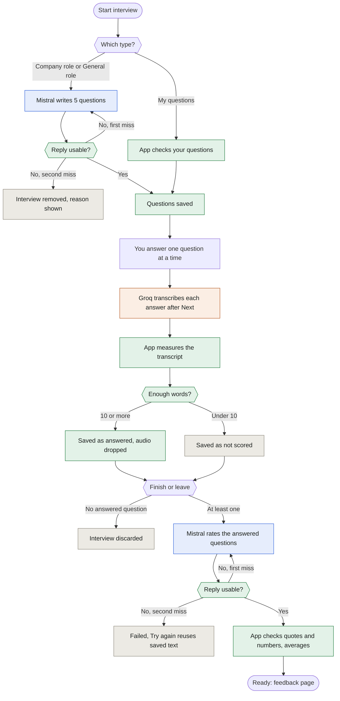
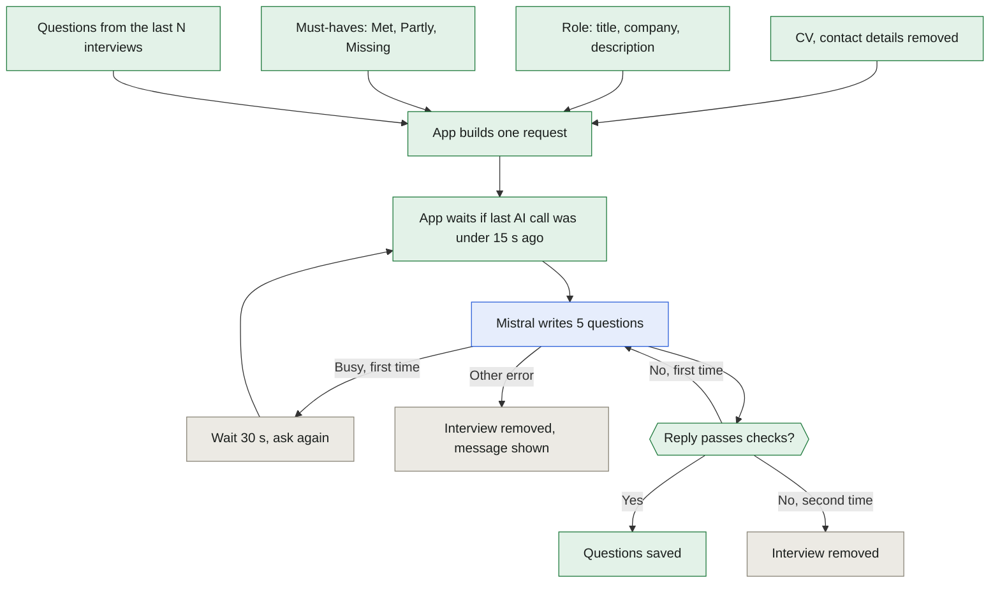
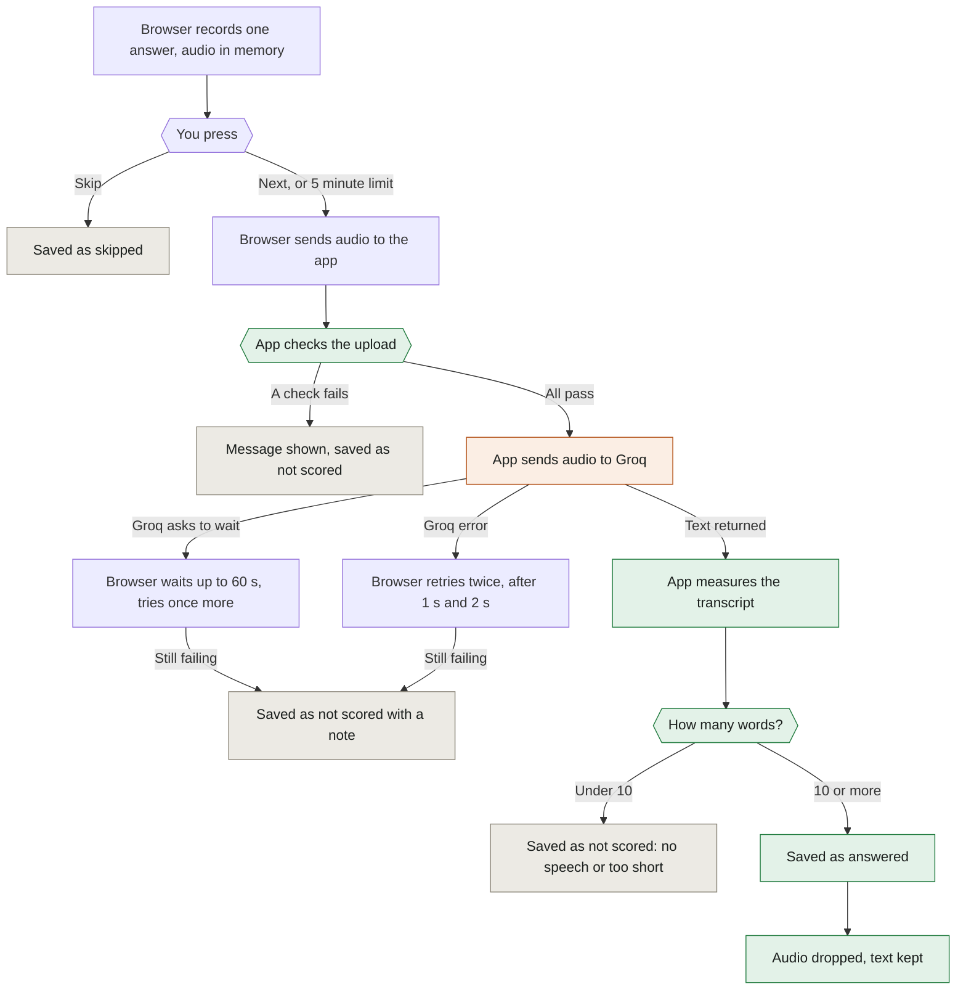
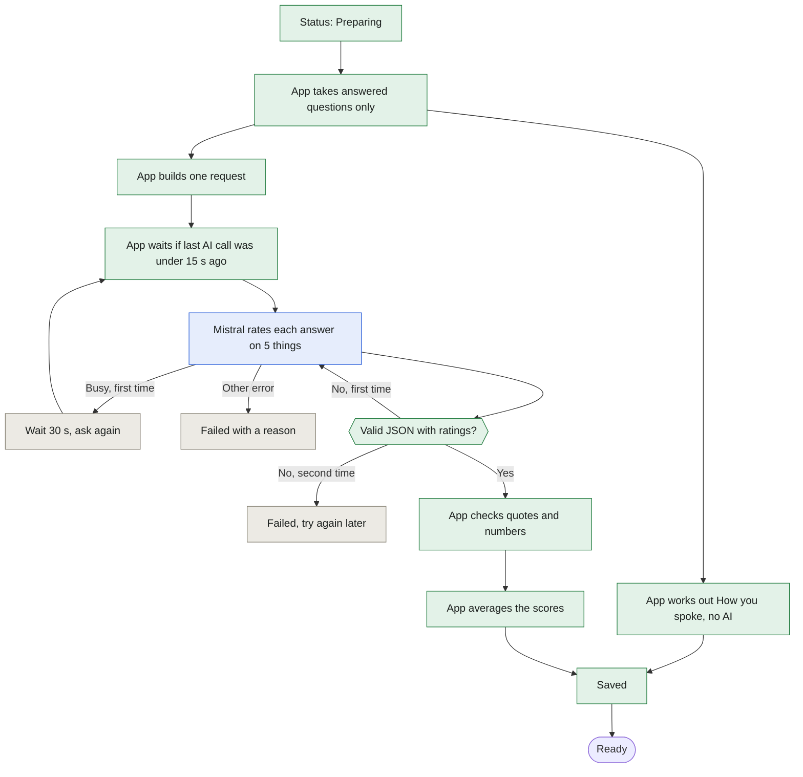
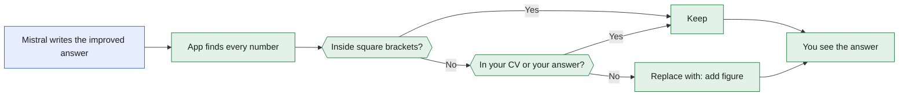
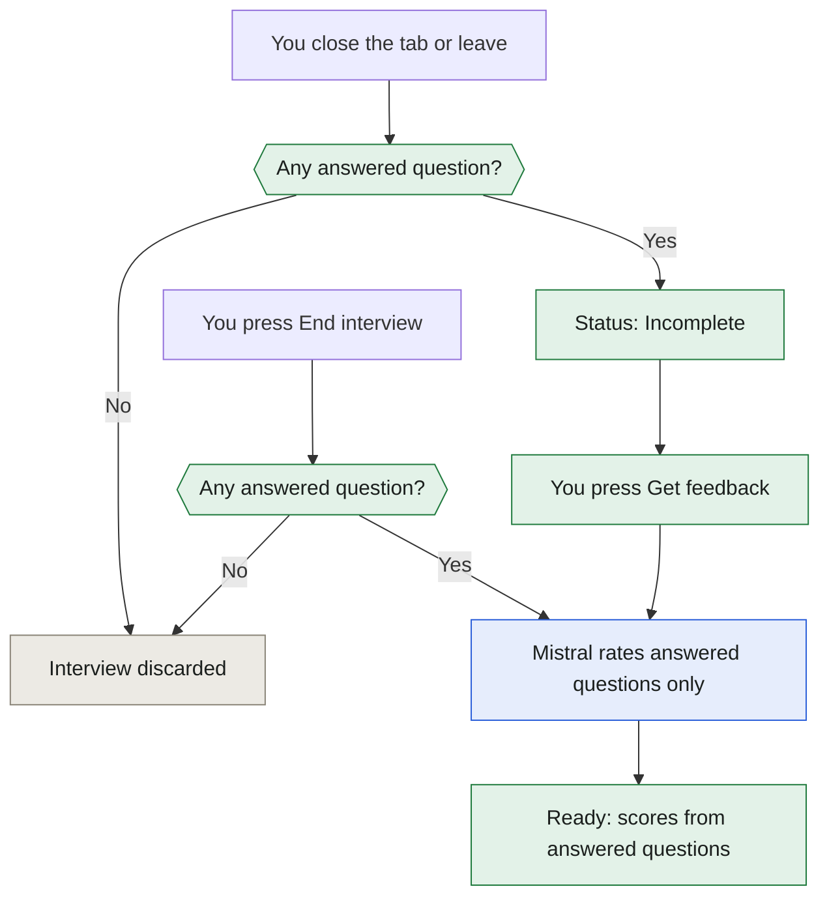

# Interview Prep: AI flow

How one practice interview runs, which model does what, and every check in between. For the product rules see [Interview Prep requirements](INTERVIEW_PREP_REQUIREMENTS.md). For the system view see the [High-level design](HIGH_LEVEL_DESIGN.md).

## 1. Who does what

| Worker | Job | Gets | Returns | Settings |
|---|---|---|---|---|
| Groq Whisper | Speech to text, once per answer | One recording (25 MB max) | Transcript, word times | `whisper-large-v3`, English, temperature 0, `GROQ_API_KEY` |
| Mistral, call 1 | Write 5 questions (not for My questions) | CV, role, must-haves, recent questions | 5 questions | Fit scoring model unless Config overrides. Temperature 0.5, 1,500 tokens |
| Mistral, call 2 | Rate answers, write feedback. One call per interview | CV, role, must-haves, questions, transcripts | Ratings, quotes, advice | Same model. Temperature 0.2, 6,000 tokens |
| App code | Measure speech, check replies, average, store | Transcripts, replies | Both scores, bands | No AI |

Colour key in the charts: blue is Mistral, orange is Groq, green is app code, grey is a stop.



## 2. Writing the questions (Mistral, call 1)

Runs in a background thread. The page polls until the questions are ready. My questions skip this step.



**Slots.** The prompt fixes five.

| Slot | Kind | Asks about |
|---|---|---|
| 1 | Introduction | Your background, tied to the role |
| 2 | Behavioural | A past case using a must-have the CV meets |
| 3 | Behavioural | A different past case |
| 4 | Situational | A realistic situation in the role |
| 5 | Gap | Something the CV shows only partly or not at all |

**Reply checks.**
- Valid JSON with exactly 5 questions.
- Each question is 30 words or fewer. One long question fails the reply.
- Slot order sets the kind, not the model.

**One limit for all three types.** Every question is at most 30 words. My questions also need 5 characters or more, and at most 5 questions.

**Must-haves.** All go to Mistral with their label. This is true for call 1 and call 2. No Fit score means none are sent. General role and My questions have none.

**Repeats.** The last N interviews of the same type and role are listed as ALREADY ASKED. N is the Config setting "Do not repeat questions from the last (interviews)". Default 5. Zero allows repeats. The model is asked to avoid them. The app does not check.

**When question writing fails.**

| Case | What you see |
|---|---|
| Reply unusable twice | Spinner stops. Red "Could not write questions. Try again." Back button. Nothing in Past History. |
| Key wrong, model missing, service busy | Same page with the plain reason. |
| App restarted meanwhile | "This interview no longer exists." Start again. |

<details><summary>Prompt: write questions</summary>

```text
SYSTEM
You write interview questions for a practice interview. Reply with one JSON object and nothing else.
Rules:
- Write exactly the questions asked for, in the order of the slots.
- One question per slot. One sentence. At most 30 words. Plain words.
- Use only facts that are in the CV. Never invent an employer, a title, a tool or a number.
- Questions must fit the role and the candidate's CV. Do not repeat or reword the questions listed under ALREADY ASKED.
- For the "gap" question, ask about something the role needs that the CV does not clearly show. Ask it as a fair question, not as an accusation.
Reply format:
{"questions": [{"slot": 1, "kind": "introduction", "text": "..."}]}

USER
CANDIDATE CV: ...        ROLE: ...
MUST-HAVES (status against the CV): - item: Met | Partly | Missing
SLOTS: 1. introduction ... 5. gap
ALREADY ASKED: - (earlier questions)
```

</details>

## 3. Recording and transcribing each answer (Groq)

Audio goes to Groq one answer at a time, right after you press Next. It does not wait for the end of the interview.



**Upload checks.**

| Check | Why | If it fails |
|---|---|---|
| Interview is still running | No late answers | "This interview is not running." |
| Question number exists | Right question | "There is no such question." |
| Recording is not empty | Nothing to transcribe | "The recording is empty." |
| File is audio | Nothing else gets in | "That file is not a recording." |
| File is under 25 MB | Groq limit, browser checks first | Not scored: "too large to send" |

**Audio lifecycle.**
1. Browser memory only. Never saved to a file.
2. After Next the browser uploads it to the local app.
3. The app holds it in memory and passes it to Groq in the same request. It drops its copy when the call ends.
4. Groq keeps what its own policy says. The app cannot delete it there.
5. Only the transcript, length and measures stay in SQLite.

**Measures from the transcript (no AI).**

| Measure | Meaning | Good |
|---|---|---|
| Words | How much you said | 10 or more to be scored |
| Pace | Words per speaking minute. Silences over 2 s excluded | 120 to 160 |
| Thinking time | Seconds before the first word | Up to 3 |
| Long pauses | Silences over 3 s | None |
| Filler words | "um", "uh", "like" per 100 words | Under 3 |
| Hedging | "I think", "maybe", "kind of" per 100 words | Under 2 |
| Ownership | "I" as a share of "I" plus "we" | 50% or more |
| Answer length | Seconds recorded, capped at 900 | 60 to 120 |

Without word times from Groq, pace and pauses are approximate and show "~".

**Answer outcomes.**

| Outcome | When | Feedback page shows |
|---|---|---|
| Answered | 10 or more words | Full feedback |
| Not scored | 0 words, 1 to 9 words, or transcription failed | "Not scored." and a short reason |
| Skipped | You pressed Skip | "Skipped. Not scored." |

A not-scored answer cannot be re-scored. The audio is gone. Zero words and 1 to 9 words are two labels in the app. "No speech" points to the microphone. "Too short" points to the answer.

## 4. Writing the feedback (Mistral, call 2)

One call covers every answered question. It starts when you end the interview or leave the page. The app does all the arithmetic.



**The five ratings (0 to 100).**

| Aspect | 80 to 100 | 60 to 79 | Under 60 |
|---|---|---|---|
| Relevance | Answers what was asked | Partly, or drifts | Misses it |
| Structure | Clear order, headline early | Hard to follow | No order |
| Specificity | Several concrete facts | A few | Generic |
| Impact and ownership | Own action and a measured result | Unclear | Neither |
| Role fit | Clear link to the role and must-haves | Weak link | No link |

Structure depends on the question. Behavioural needs situation, action, result. Situational needs steps. Introductions need present, past, future.

**What the app does with the reply.**
1. **Quote check.** Each rating has a quote of 15 words or fewer. If it is not in your transcript, the rating drops to 60 at most and shows "capped".
2. **Number check.** See section 5.
3. **Missing answers.** If the model skips one, the rest are kept. The skipped one says "Feedback was not returned for this answer."
4. **Length limits.** Reasons 400 characters. Improved answer 2,500. Three items each for what worked, work on next and top tips.

**Top 3 tips.**
1. One tip from How you spoke. The app picks the worst measure. Weak comes before Needs work. Each measure has a fixed tip.
2. Then the model's tips. Repeats removed. Three at most.

<details><summary>Prompt: review answers</summary>

```text
SYSTEM
You are a strict, fair interview coach. You read a candidate's spoken answers (as transcripts) and give feedback. Reply with one JSON object and nothing else.
Rate each answer from 0 to 100 on five things. Use these ranges.
- relevance: 80-100 answers exactly what was asked, nothing off-topic. 60-79 partly answers or drifts. Under 60 misses the question.
- structure: behavioural answers need situation, action, result. Situational answers need steps. An introduction needs present, past, future. 80-100 clear order, headline early. 60-79 hard to follow. Under 60 no order.
- specificity: 80-100 several concrete facts (names, numbers, details). 60-79 a few. Under 60 generic.
- impact: own decisions and a real result. 80-100 own action and a measured result. 60-79 result or ownership unclear. Under 60 neither stated.
- role_fit: links the answer to the role's needs and must-haves. 80-100 clear link. 60-79 weak link. Under 60 no link.
Rules:
- Judge only what the transcript says. Use the CV and the role only to judge relevance, specificity and role fit.
- For every rating give a short reason and a quote: at most 15 words copied exactly from the answer. A rating with no exact quote will be lowered.
- Never add facts that are not in the CV or the answer. In "improved", write a model answer of 130 to 200 words. Where a fact is missing, write a placeholder in square brackets, such as [add your budget figure]. Never invent employers, titles or numbers.
- Write short plain sentences. "worked" has 2 or 3 points. "next" has 1 to 3 items, each with a short title, why it matters, and one concrete fix. "top_tips" has up to 3 short tips for the next interview.
Reply format: {"answers": [{"q": 1, "ratings": {five aspects, each {"score","reason","quote"}}, "verdict": "", "worked": [""], "next": [{"title","why","fix"}], "improved": ""}], "top_tips": [""]}

USER
CANDIDATE CV: ...        ROLE: ...
MUST-HAVES (status against the CV): - item: Met | Partly | Missing   (Company role only)
ANSWERS:
[Question 1] ...
[Answer 1] (transcript)
```

</details>

## 5. Improved answer and number check

Mistral writes a model answer for each question. The risk is invented numbers. The app replaces any number that is not in your CV or your own answer.



Example. Your CV has "5 teams". Mistral writes "I led 5 teams and cut cost by 40%. We saved [add your saving]."
- "5" is in the CV. Kept.
- "40" is in neither. Replaced.
- The bracket text is already a placeholder. Kept.

Result: "I led 5 teams and cut cost by [add figure]%. We saved [add your saving]."

The check sees digits only. An invented employer passes. The prompt forbids it. Code does not check it.

## 6. How scores are made

**Answer feedback score** (Mistral rates, app calculates)
1. Mistral gives 5 ratings per answer.
2. App lowers a rating to 60 if its quote is not in your transcript.
3. Answer score is the average of the 5, rounded half up.
4. Interview score is the average of the answer scores, rounded half up.

Example. Answer 1: 70, 60, 50 (capped from 80), 40, 50. Sum 270, score 54. Answer 2: 78. Interview: (54 + 78) / 2 = 66. Band: Good.

**How you spoke score** (app only)
1. Rate each of the 7 measures Good, Needs work or Weak.
2. Points: Good 100, Needs work 60, Weak 25.
3. Score is the average of the 7, rounded half up.

Example. 100, 100, 60, 100, 25, 60, 100. Sum 545, score 78. Band: Good.

**Minimum speech.**
- 10 words per answer. Below it the answer is not scored.
- 50 words in total across scored answers. Below it How you spoke shows no score. Filler and hedge rates are per 100 words and need enough words.

**Bands.** Three words everywhere: each spoken measure, each answer score, both overall scores.

| Band | Score |
|---|---|
| Good | 65 to 100 |
| Needs work | 50 to 64 |
| Weak | Under 50 |

**Change since last time.** Score now minus the latest earlier Ready interview of the same role, or the same title for General role. Under 5 points shows "about the same". Not shown for My questions.

## 7. Unfinished interviews

Answers are saved one by one. Scores appear only after feedback runs.



Example: 2 of 5 answered.
- Past History shows "2 of 5 answered" and **Get feedback**.
- Scores cover those 2 answers only.
- How you spoke needs 50 words in total.
- The question in progress is lost. Its audio was never sent.
- If the close signal never arrives, the interview stays In progress. The start page shows "Go to your interview".

## 8. What leaves your computer

| To | Sent | Not sent |
|---|---|---|
| Groq | One answer's audio per request | CV, role, questions, other answers |
| Mistral | CV with contact details removed, role, questions, transcripts | Audio, the database |
| Langfuse | Nothing from interviews | Everything |

Local SQLite keeps transcripts, scores and feedback. Audio is never written to disk. Usage counts (calls, time, tokens, retries, errors) are kept without any text.

## 9. Failures

| What fails | What happens | What you see |
|---|---|---|
| Microphone refused or missing | Waits at the mic check | Cause named, Try again |
| Question writing | Interview removed | Red message, Back button |
| Groq busy | Browser waits up to 60 s, tries once more | Nothing unless it still fails |
| Groq error | Browser retries twice | "Not scored" on that answer |
| Mistral busy | App waits 30 s, asks once more | A longer wait |
| Mistral reply unusable | One more attempt | Failed with reason, Try again |
| App closed while Preparing | Becomes Failed at next start | Try again in Past History |
| Browser closed mid-interview | Incomplete if anything answered, else deleted | Get feedback in Past History |

## 10. Known gaps

| Gap | Status |
|---|---|
| No re-score for a not-scored answer. Audio is not kept. | Accepted |
| One model grades and coaches. A quote proves presence, not support. | Accepted |
| Number check sees digits only. | Accepted |
| Call pacing is per app process. | Accepted |
| Groq word times unverified. Docs disagree. | Test with one recording |
| Mistral may train on API data unless "Anonymous improvement data" is off. Groq retention unconfirmed. | Owner decision |
